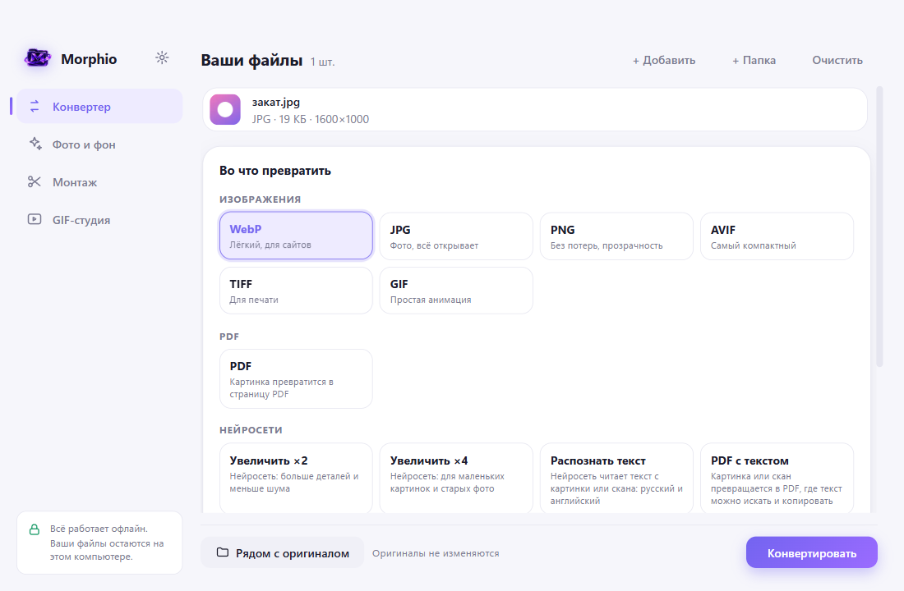
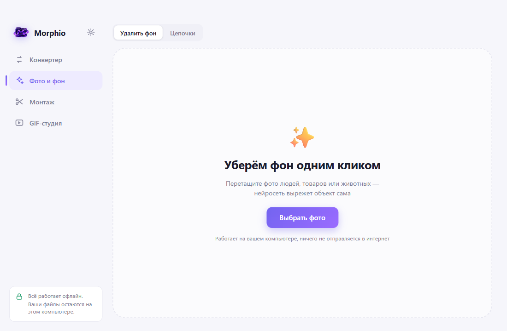
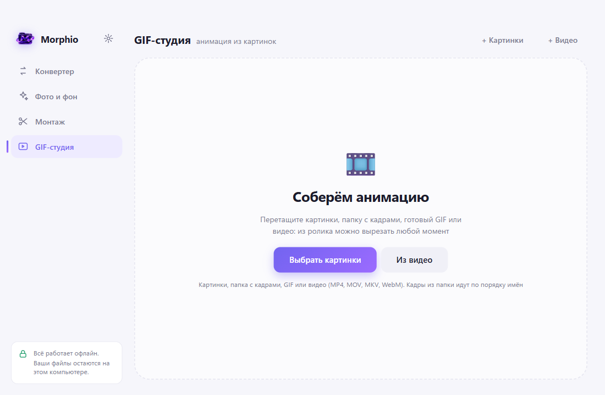
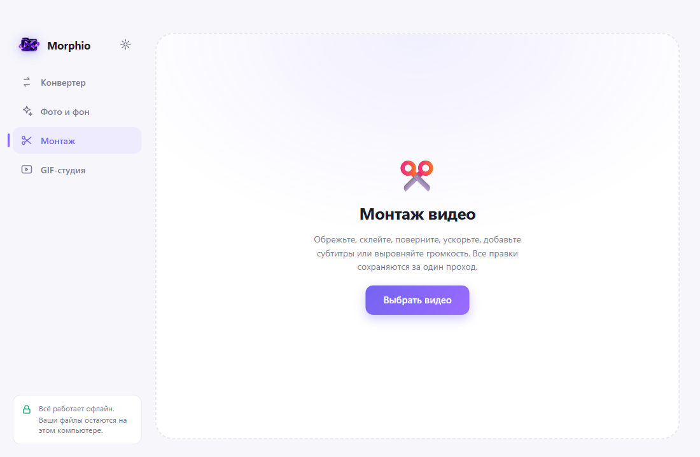

# Morphio



**English** · [Русский](#русский)

---

## English

A free file converter for Windows that works **fully offline**. It sends nothing to the network.

**What it does**
- Converts images, video, audio, tables, archives, PDF, documents and books (many formats, quality and size limits, batch queue, GPU acceleration)
- Background removal (solid colour or neural network) with a brush and fill tool
- GIF studio: GIF, WebP and APNG with text, stickers, crop and speed control
- Video montage: trim, join, rotate, speed, subtitles, loudness, transitions, silence removal
- Subtitles (SRT, VTT, ASS), speech to text, text recognition (OCR), photo enlargement
- Before/after preview, chains of actions, folder watching, quick window (`Ctrl+Shift+X`), Explorer menu
- Command line: `morphio convert photo.png --to webp`, `morphio gif video.mp4`, `morphio --help`

### Download and install

1. Open [Releases](https://github.com/Omorriiz/Morphio/releases/latest) and download:
   - **`Morphio-Setup-<version>.exe`**: the installer (recommended). No administrator rights needed, shortcuts, fast start, the `morphio` command in the console, optional auto-update (off by default; turn it on in Settings).
   - or **`Morphio-Portable-<version>.exe`**: no installation, but every start is slower.
2. Windows may show "Windows protected your PC" because the files are not signed yet. Click *More info → Run anyway*. You can check the file against `SHA256SUMS.txt` on the same page.
3. Start Morphio, drop files into the window, choose the result and press "Convert". Originals are never changed.

**Extra modules.** Neural networks and Pandoc are not bundled. When a feature needs one, a "Download" button appears next to it. A module is downloaded once and then works offline. Without modules, conversion, video, audio, archives, GIF and solid-colour background removal work.

**Something is wrong?** Settings → "About and data" → "Report a problem". It opens an issue page with the version and a log in which your user name is hidden.

**Requirements:** Windows 10 or 11, 64-bit, about 750 MB of disk space (without modules).

**Privacy:** no telemetry, no uploads. Settings and the log stay in `%APPDATA%\Morphio`. Update checks are off until you turn them on; downloading and installing an update always needs your button press.

### Build from source

Windows, Node.js 22:

```powershell
npm ci
npm run dev       # development window
npm run check     # types, translations, unit tests
npm run e2e       # tests in a real Electron window
npm run dist      # installer and portable exe in release/
```

Release steps: [docs/RELEASE.md](docs/RELEASE.md). Manual test list: [TESTING.md](TESTING.md). Security: [SECURITY.md](SECURITY.md).

### Licence

GPL-3.0-or-later, see [LICENSE](LICENSE). Morphio runs FFmpeg (GPL-3.0) as a separate program; third-party components are listed in [THIRD_PARTY_NOTICES.txt](THIRD_PARTY_NOTICES.txt).

<details><summary>Screenshots</summary>





</details>

---

## Русский

Бесплатный конвертер для Windows, который работает **полностью без интернета**. Ничего не отправляет в сеть.

**Что умеет**
- Конвертирует картинки, видео, звук, таблицы, архивы, PDF, документы и книги (много форматов, лимиты качества и размера, очередь, ускорение на видеокарте)
- Удаляет фон (однотонный или нейросетью), есть кисть и инструмент «Заливка»
- GIF-студия: GIF, WebP и APNG с текстом, стикерами, обрезкой и управлением скоростью
- Монтаж видео: обрезка, склейка, поворот, скорость, субтитры, громкость, переходы, вырезание тишины
- Субтитры (SRT, VTT, ASS), речь в текст, распознавание текста (OCR), увеличение фото
- Сравнение «до и после», цепочки действий, следящие папки, быстрое окно (`Ctrl+Shift+X`), меню Проводника
- Командная строка: `morphio convert photo.png --to webp`, `morphio gif video.mp4`, `morphio --help`

### Скачать и установить

1. Откройте страницу [Releases](https://github.com/Omorriiz/Morphio/releases/latest) и скачайте:
   - **`Morphio-Setup-<версия>.exe`** — установщик (рекомендуется). Права администратора не нужны, появятся ярлыки, быстрый запуск, команда `morphio` в консоли, автообновление (по умолчанию выключено, включается в Настройках).
   - или **`Morphio-Portable-<версия>.exe`** — без установки, но каждый запуск медленнее.
2. Windows может показать «Windows защитила ваш компьютер»: файлы пока не подписаны. Нажмите *Подробнее → Выполнить в любом случае*. Проверить файл можно по `SHA256SUMS.txt` на той же странице.
3. Запустите Morphio, перетащите файлы в окно, выберите результат и нажмите «Конвертировать». Оригиналы не изменяются.

**Дополнительные модули.** Нейросети и Pandoc не вшиты в программу. Когда функции нужен модуль, рядом появляется кнопка «Скачать». Модуль скачивается один раз и дальше работает офлайн. Без модулей работают конвертация, видео, звук, архивы, GIF и удаление однотонного фона.

**Что-то не работает?** Настройки → «О программе и данные» → «Сообщить о проблеме». Откроется страница обращения с версией и журналом, в котором скрыто ваше имя пользователя.

**Требования:** Windows 10 или 11, 64 бита, около 750 МБ на диске (без модулей).

**Приватность:** без телеметрии и загрузок на сервер. Настройки и журнал лежат в `%APPDATA%\Morphio`. Проверка обновлений выключена, пока вы её не включите; скачивание и установка обновления всегда только по вашей кнопке.

### Сборка из исходников

Windows, Node.js 22:

```powershell
npm ci
npm run dev       # окно для разработки
npm run check     # типы, переводы, модульные тесты
npm run e2e       # тесты в настоящем окне Electron
npm run dist      # установщик и портативный exe в release/
```

Как выпускать версии: [docs/RELEASE.md](docs/RELEASE.md). Ручная проверка: [TESTING.md](TESTING.md). Безопасность: [SECURITY.md](SECURITY.md).

### Лицензия

GPL-3.0-or-later, см. [LICENSE](LICENSE). Morphio запускает FFmpeg (GPL-3.0) как отдельную программу; сторонние компоненты перечислены в [THIRD_PARTY_NOTICES.txt](THIRD_PARTY_NOTICES.txt).
